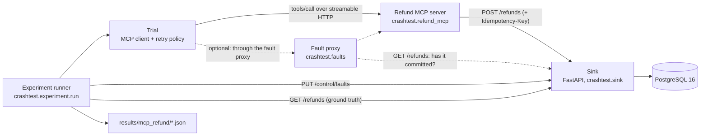

# Architecture

Final for the MVP. The checked properties and verdicts are in [contract.md](contract.md).

---

## 1. What exists today

Two more runners use the same sink and proxy: `single_call` runs one tool call through an external client library, and `langgraph_crash` kills and resumes an agent process. Each system under test is a script in `subjects/`, run in its own Python environment.

| Component | Module | Responsibility |
|---|---|---|
| Sink | `src/crashtest/sink/` | Fake payments API. Records every refund and every request. Enforces idempotency keys with a unique index. Injects the lost-response fault. |
| Refund MCP server | `src/crashtest/refund_mcp/` | `issue_refund`, which forwards the optional key to the sink and adds no deduplication of its own, and the read-only `check_refund_status`. Streamable HTTP (`crashtest serve`) or stdio (`crashtest mcp --stdio`). |
| Checker | `src/crashtest/checker.py` | The one place a verdict is decided, from the sink's count and the subject's final status. |
| Fault proxy | `src/crashtest/faults/drop_proxy.py` | Sits between a client and the MCP server. Counts the tool calls the client sent, and when armed cuts the connection: after the sink has committed, or (experiment 008) before the request reaches the server, or mid-stream before the commit. |
| Trial | `src/crashtest/experiment/trial.py` | One logical operation under one retry strategy and one fault. |
| Runner | `src/crashtest/experiment/run.py` | Runs every (transport, fault, strategy) cell and writes a results file with versions and parameters. |
| Single-call runner | `src/crashtest/experiment/single_call.py` | One tool call through an external client library; counts the requests it became. |
| Crash runner | `src/crashtest/experiment/langgraph_crash.py` | Hard-kills a subject process at a chosen point, resumes it, counts the refunds. |
| Subjects | `subjects/` | One script per system under test. |
| Local stack | `src/crashtest/experiment/local_stack.py` | Starts PostgreSQL, the sink and one MCP server per transport without Docker. |

## 2. Target for the MVP

The pieces still to add, in order:

| Piece | Purpose | Replaces or extends |
|---|---|---|
| Scripted LLM | OpenAI-compatible server returning scripted tool calls, so agent runs are deterministic and free | New. **Interim:** an in-process scripted model inside the LangGraph subject, which other frameworks cannot reuse |
| Injector | Runs a subject in a container and kills it at K1, K3, K4, K5 | Extends the sink-side K2 fault. **Interim:** `langgraph_crash` kills a host process at two points |
| Subjects | LangGraph + PostgreSQL saver; pydantic-ai + DBOS with a plain tool and with a `@DBOS.step` tool | New; each wraps the same scenarios. **Both exist** (004 and 005; status updated 23 November 2026) |
| Checker | Shared verdict logic for all subjects, including `in_doubt_surfaced` and `stuck` | **Done:** `src/crashtest/checker.py` |
| Result store | PostgreSQL tables for runs and trials, replacing loose JSON files | Extends the runner. **Done:** `src/crashtest/results/` (status updated 23 November 2026) |

Not in the MVP: the scoreboard site, nightly CI matrix, real-model studies, and the live demo. (23 November 2026: one real-model study was run anyway, experiment 006, and the README now has a generated results table, moved to `docs/research.md` on 28 November; the scoreboard site, nightly matrix and live demo are still not built.)

## 3. Decisions

| Decision | Choice | Why |
|---|---|---|
| Where the truth lives | A separate network service with its own database | An in-process counter cannot be trusted across a process kill, and a real service is what tools call in practice. The closest prior work lists its local counter as a validity threat. |
| Database | PostgreSQL | Atomic claim with `INSERT … ON CONFLICT DO NOTHING` on a partial unique index; it is also what postings name and what the frameworks' savers support. |
| Database access | psycopg 3 with raw SQL, no ORM | The deduplication statement is the point of the service; an ORM would hide it. |
| Effect and request log | Written in one transaction | A request that is logged always has its effect committed, and the reverse. |
| Fault trigger | Armed per order in the database; consumed only by a request that creates an effect | Deterministic. The fault fires after the commit, so the window being tested is exact. A replay or a conflict commits nothing new and leaves the fault armed. |
| Fault record | Each request-log row says whether a fault was applied to it | A results file can then show the fault fired, instead of inferring it from the client's timeout. |
| K2 simulation | Delay the response past the client timeout | Portable, needs no socket tricks, and is indistinguishable from a lost response at the caller. |
| Connection drop | A TCP proxy in the runner's process, armed in memory, not in the database | The sink cannot cut a connection between two other parties. For a cut after the commit, the proxy asks the sink whether the refund has committed before it cuts; for 008's two cuts it reads the sink at the cut. It records each drop. |
| Second counting point | The proxy counts the tool calls each client sent | Requests are otherwise counted only at the sink, two hops from the client. The second count separates "the client resent" from "a request never arrived". |
| Ground-truth read | Twice per trial, with a short pause between | A request that timed out with no fault may still be in flight at the first read. A change between the reads is recorded. |
| MCP transport | Streamable HTTP; stateless with JSON responses by default | Removes sessions and streaming from the first experiment so that only retry behaviour varies. Experiment 002 adds stateful sessions and SSE. |
| One connection per attempt | Yes | The retry must not depend on the state of a timed-out session. |
| Key in tool arguments | `idempotency_key` is an ordinary optional tool argument | MCP has no protocol-level key ([spec #3394](https://github.com/modelcontextprotocol/modelcontextprotocol/issues/3394)), so this is the only place an application can put one today. |
| Payload check on replay | Same key with a different body returns 409 | Returning the old refund for a different request would hide a caller bug. |
| Running without Docker | `pgserver` (pip-installed PostgreSQL) plus subprocesses | Lets the same code run and be tested on a machine where Docker is unavailable. Docker Compose remains the documented way to run the services. |
| Windows event loop | The sink starts uvicorn itself with a selector loop | psycopg's async mode cannot run on Windows' default Proactor loop. |

## 4. Data model

`refunds` — one row per effect.

| Column | Notes |
|---|---|
| `id` | Primary key; returned as `refund_id` |
| `order_id`, `amount_cents` | Business payload |
| `idempotency_key` | Nullable; unique where not null |
| `request_hash` | SHA-256 of the canonical payload, for the replay check |
| `created_at` | Start time of the transaction that committed the row |

`request_log` — one row per request that reached a decision, with `outcome` of `created`, `replayed` or `conflict`, and `fault_applied`. A request rejected by validation is not logged.

`faults` — armed faults: `order_id`, `mode`, `delay_s`, `remaining`. `remaining` counts effect-creating requests still to be delayed.

## 5. Interfaces

| Service | Endpoint | Purpose |
|---|---|---|
| Sink | `POST /refunds` | Perform a refund. Optional `Idempotency-Key` header. Returns `refund_id` and `replayed`. |
| Sink | `GET /refunds?order_id=` | Effects and requests recorded for one order. |
| Sink | `PUT /control/faults` | Arm a fault for one order. Requires the control token. |
| Sink | `POST /control/reset` | Wipe all state (test helper). Requires the control token. |
| Sink | `GET /health` | Liveness, including a database round trip. |
| MCP server | tool `issue_refund(order_id, amount_cents, idempotency_key?)` | The side-effecting tool under test. |
| MCP server | tool `check_refund_status(order_id)` | Read-only: whether a refund exists for the order. |
| Test controller | tools `create_test_run`, `configure_scenario`, `arm_fault`, `get_run_status`, `get_test_report` | For the developer, never the agent (`crashtest controller`, [controller.md](controller.md)). |

## 6. Security notes for the test rig

- Every effect is fake; nothing reaches a real payment system.
- The HTTP MCP servers check the `Host` and `Origin` headers (DNS-rebinding protection): only `127.0.0.1`, `localhost` and `[::1]`, plus the container names Docker Compose lists in `MCP_ALLOWED_HOSTS`.
- The control endpoints require a control token (since 0.3.0), which the agent under test is never given; `GET /refunds` stays open and read-only. The services must not be exposed beyond the local machine.
